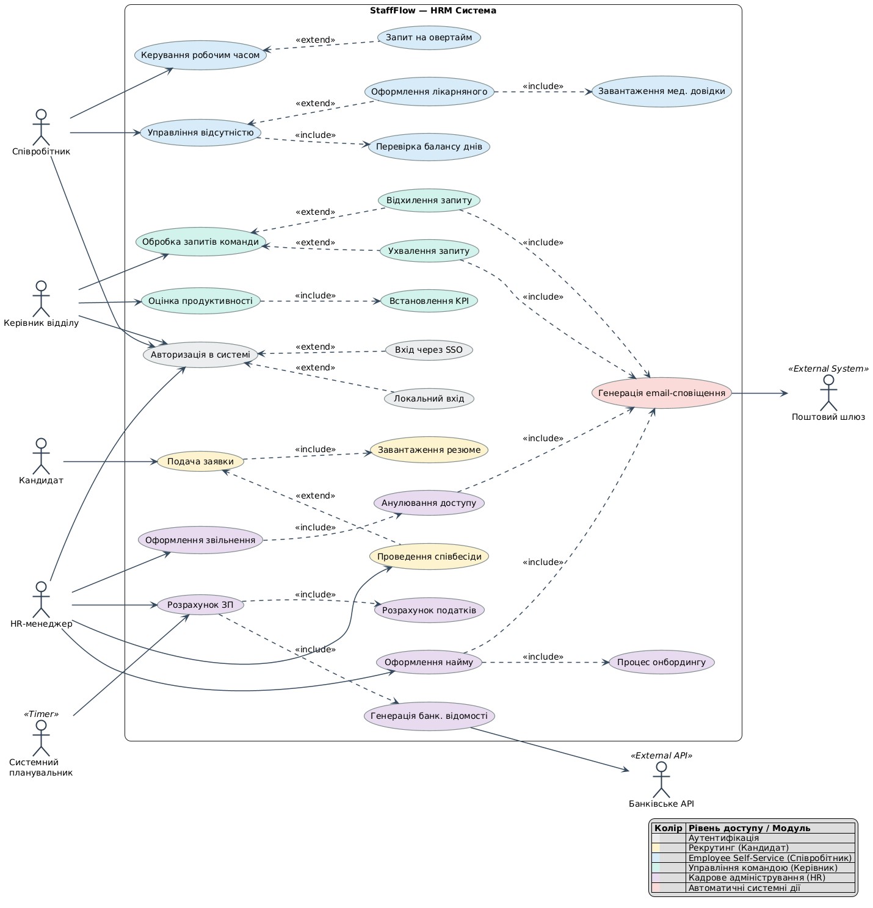
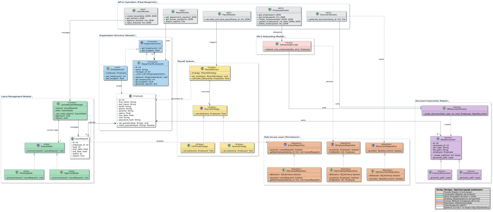
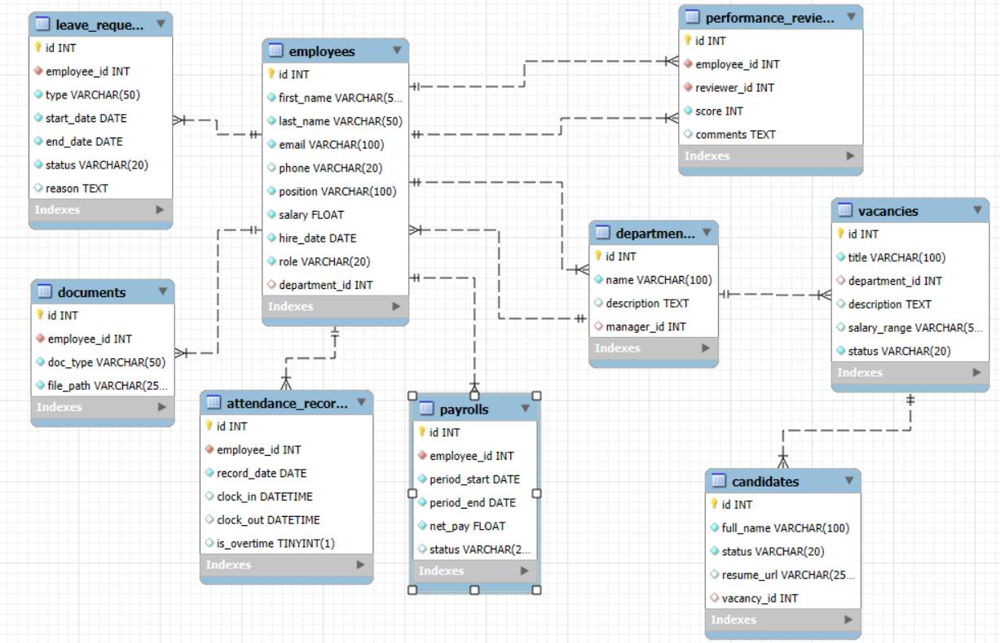

# TeamSync-HRM — Human Resource Management System

**TeamSync-HRM** is a full-stack Human Resource Management web application designed to streamline employee onboarding, leave workflows, payroll calculations, document generation, and HR analytics. Built with a Flask REST API backend and a Flutter Web frontend, the system follows a clean layered architecture powered by GoF design patterns and SOLID principles.

---

## 🚀 Key Features

- **Employee Directory & Onboarding:** Full CRUD management of employee records, department assignments, and automated onboarding via a unified Facade.
- **Role-Based Access Control (RBAC):** Secure JWT authentication separating permissions for `admin`, `hr`, `manager`, and `user` roles.
- **Leave Management:** Automated leave request submission, approval, and rejection workflows managed by a State machine.
- **Dynamic Payroll System:** Flexible salary calculation supporting multiple compensation models (Full-Time and Hourly) via the Strategy pattern.
- **HR Document Generation:** Automated PDF generation for employment contracts and internal orders using HTML templates and Factory Method.
- **Time & Attendance / Reviews:** Daily clock-in/clock-out shift tracking and employee performance reviews.
- **HR Analytics & Reporting:** Real-time departmental headcount and payroll budget aggregation (Composite pattern) with PDF report export.

---

## 🛠 Tech Stack

| Layer | Technologies |
| :--- | :--- |
| **Backend** | Python 3, Flask, Flask-SQLAlchemy, Flask-JWT-Extended, Flask-CORS, Marshmallow, ReportLab |
| **Frontend** | Flutter Web (Dart), BLoC / Cubit (State Management), GoRouter (Navigation & Guards), Material 3 |
| **Database** | SQLite (via SQLAlchemy ORM) |
| **Architecture** | Layered Architecture (Blueprints → Services → Domain Models → Repositories), GoF Patterns, SOLID |

---

## 🏗 System Architecture & Design Patterns

The backend is structured into four distinct layers (**API/Blueprints**, **Services**, **Domain Models**, and **Data Access Layer**) and implements the following patterns:

| Pattern | Category | Implementation | Responsibility |
| :--- | :--- | :--- | :--- |
| **Facade** | Structural (GoF) | `OnboardingFacade` | Provides a single entry point (`onboard_new_employee`) that coordinates DB persistence and initial contract generation. |
| **Composite** | Structural (GoF) | `IOrganizationUnit`, `DepartmentComposite`, `EmployeeLeaf` | Represents departments and employees as a tree structure to recursively calculate headcount and payroll budgets. |
| **Factory Method** | Creational (GoF) | `HRDocumentFactory`, `BaseDocument`, `ContractDocument`, `OrderDocument` | Dynamically instantiates and renders PDF documents based on document type without modifying client code (OCP). |
| **State** | Behavioral (GoF) | `LeaveRequestManager`, `ILeaveState`, `PendingState`, `ApprovedState` | Encapsulates leave request lifecycle transitions and prevents invalid state operations. |
| **Strategy** | Behavioral (GoF) | `PayrollService`, `IPayrollStrategy`, `FullTimeStrategy`, `HourlyStrategy` | Allows runtime switching between salary calculation algorithms depending on employee contract terms. |
| **Repository** | Architectural | `IEmployeeRepository`, `ILeaveRepository`, `IDocumentRepository` (+ SQL implementations) | Abstracts SQLAlchemy session operations from business logic (Dependency Inversion Principle). |

### Documentation & Diagrams

- **Business Processes (Use Cases):** [docs/use_cases.md](docs/use_cases.md)

  

- **Class Architecture (UML & GoF):** [docs/class_diagram.md](docs/class_diagram.md)

  

- **Database Schema (ER Diagram):** [docs/database_schema.md](docs/database_schema.md)

  
---

## 📂 Project Structure

```text
TeamSync-HRM/
├── backend/
│   ├── app/
│   │   ├── __init__.py                   # Flask app initialization & extensions
│   │   ├── models/
│   │   │   └── models.py                 # SQLAlchemy ORM models
│   │   ├── repositories/                 # Data Access Layer (Repository pattern)
│   │   │   ├── employee_repository.py    # SQLEmployeeRepository
│   │   │   ├── leave_repository.py       # SQLLeaveRepository
│   │   │   └── document_repository.py    # SQLDocumentRepository
│   │   ├── routes/                       # Flask Blueprints (REST API controllers)
│   │   │   ├── auth_routes.py            # Login & JWT token generation
│   │   │   ├── employee_routes.py        # Employee CRUD & onboarding
│   │   │   ├── leave_routes.py           # Leave request workflows
│   │   │   ├── payroll_routes.py         # Payroll calculation endpoints
│   │   │   ├── document_routes.py        # PDF document generation
│   │   │   ├── report_routes.py          # Analytics & PDF report export
│   │   │   ├── review_routes.py          # Performance reviews
│   │   │   └── time_routes.py            # Clock-in / clock-out tracking
│   │   ├── schemas/
│   │   │   └── schemas.py                # Marshmallow serialization schemas
│   │   ├── services/                     # GoF Design Patterns implementation
│   │   │   ├── onboarding_facade.py      # Facade pattern
│   │   │   ├── document_factory.py       # Factory Method pattern
│   │   │   ├── leave_state.py            # State pattern
│   │   │   ├── organization_composite.py # Composite pattern
│   │   │   └── payroll_strategy.py       # Strategy pattern
│   │   └── templates/                    # HTML templates for PDF rendering
│   ├── seed.py                           # Database seeding script
│   ├── run.py                            # Flask server entry point
│   └── requirements.txt                  # Python dependencies
│
└── frontend/
    ├── lib/
    │   ├── core/                         # App-wide configuration
    │   │   ├── api/
    │   │   │   └── api_client.dart       # Centralized HTTP client
    │   │   ├── router/
    │   │   │   └── app_router.dart       # GoRouter setup & Route Guards
    │   │   └── theme/                    # Material 3 theme configuration
    │   ├── features/                     # Feature-first modules
    │   │   ├── auth/                     # Authentication module
    │   │   ├── dashboard/                # Main dashboard
    │   │   ├── employees/                # Employee management (cubit, models, views)
    │   │   ├── leaves/                   # Leave management module
    │   │   └── reports/                  # Analytics & reports module
    │   ├── shared/
    │   │   └── widgets/                  # Reusable UI components
    │   └── main.dart                     # Flutter entry point
    ├── pubspec.yaml                      # Flutter dependencies
    └── web/                              # Web build configuration

```

---

## ⚙️ Local Setup & Installation

### Prerequisites

* **Python 3.10+**
* **Flutter SDK 3.x+** (with Chrome installed for Web target)
* **Git**

### 1. Clone the Repository

```bash
git clone [https://github.com/](https://github.com/)<your-username>/TeamSync-HRM.git
cd TeamSync-HRM

```

### 2. Backend Setup (Flask)

```bash
cd backend

# Create and activate a virtual environment
python -m venv venv

# Windows:
venv\Scripts\activate
# macOS / Linux:
source venv/bin/activate

# Install dependencies
pip install -r requirements.txt

# Initialize and seed the SQLite database
python seed.py

# Start the Flask development server (runs on [http://127.0.0.1:5000](http://127.0.0.1:5000))
python run.py

```

### 3. Frontend Setup (Flutter Web)

Open a new terminal window in the project root:

```bash
cd frontend

# Install Flutter packages
flutter pub get

# Run the application in Chrome
flutter run -d chrome

```
---

## 🤝 Contact

If you have any questions regarding the architecture, implementation, or setup of **TeamSync-HRM**, feel free to reach out:

- **GitHub:** [@Dan-Krod](https://github.com/Dan-Krod)
- **Repository:** [TeamSync-HRM](https://github.com/Dan-Krod/TeamSync-HRM)
